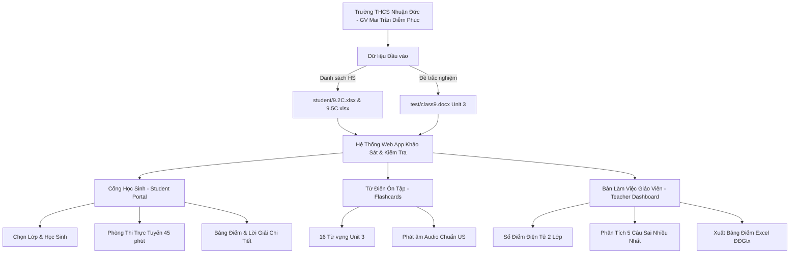

# Kế Hoạch Xây Dựng Ứng Dụng Khảo Sát & Kiểm Tra Tiếng Anh THCS Nhuận Đức

## 1. Tổng quan dự án (Project Overview)
Xây dựng một nền tảng Web App kiểm tra, ôn tập và quản lý điểm số Tiếng Anh trực tuyến theo mô hình **Azota**, được tùy biến chuyên biệt cho **Trường THCS Nhuận Đức** (giáo viên phụ trách: **Mai Trần Diễm Phúc**). 

Hệ thống tập trung phục vụ trước mắt cho **Khối 9** với bộ đề trọng tâm **Unit 3: Healthy Living for Teens** (40 câu trắc nghiệm ngữ cảnh đối thoại + 16 từ vựng cốt lõi) và dữ liệu thực tế của 2 lớp:
- **Lớp 9.2C:** 43 học sinh ([9.2C.xlsx](file:///c:/Users/X13/Desktop/mtdp/student/9.2C.xlsx))
- **Lớp 9.5C:** 29 học sinh ([9.5C.xlsx](file:///c:/Users/X13/Desktop/mtdp/student/9.5C.xlsx))
- *Sẵn sàng mở rộng:* Lớp **8.3C** (39 học sinh - [8.3C.xlsx](file:///c:/Users/X13/Desktop/mtdp/student/8.3C.xlsx)) và các khối lớp khác.

---

## 2. Mục tiêu then chốt (Key Objectives)
1. **Dành cho Học sinh (Student Experience):**
   - Đăng nhập/xác thực cực nhanh không cần tài khoản rườm rà (chọn lớp và tìm đúng tên trong danh sách lớp trích xuất từ CSDL ngành).
   - Trải nghiệm làm bài thi mượt mà: đồng hồ đếm ngược, bảng ma trận 40 câu hỏi chuyển câu tức thì, đặt cờ câu hỏi phân vân, tự động lưu bài khi rớt mạng.
   - Chấm điểm ngay lập tức trên thang điểm 10 chuẩn GD&ĐT, hiển thị bảng phân tích đáp án đúng/sai kèm giải nghĩa từ vựng và dịch ngữ cảnh tiếng Việt.
2. **Dành cho Giáo viên (Teacher Management):**
   - Bảng theo dõi điểm số trực tuyến (Live Gradebook) theo từng lớp với bộ lọc trạng thái và tìm kiếm học sinh.
   - Thống kê tỷ lệ hoàn thành, điểm trung bình, phân bố phổ điểm.
   - **Phân tích câu hỏi khó (Item Analysis):** Tự động phát hiện 5 câu học sinh sai nhiều nhất để giáo viên ôn tập lại trên lớp.
   - **Xuất bảng điểm Excel ĐĐGtx:** Tải về bảng điểm tương thích 100% với mẫu sổ điểm của trường THCS Nhuận Đức, tự động điền cột điểm kiểm tra thường xuyên.
3. **Mô-đun Ôn tập Từ vựng:**
   - Flashcards 16 từ vựng Unit 3 với phiên âm IPA, nghĩa tiếng Việt, câu ví dụ và tích hợp giọng đọc bản ngữ US (Speech Synthesis).

---

## 3. Lộ trình triển khai theo các giai đoạn (Phase Roadmap)

| Giai đoạn | Tên Phase | Trọng tâm công việc | Thời lượng ước tính | File chi tiết |
| :---: | :--- | :--- | :---: | :--- |
| **Phase 1** | **Core Data & Student Model** | Chuẩn hóa dữ liệu học sinh 2 lớp 9, schema lưu trữ, trích xuất cấu trúc đề thi | 3h | [`phase-01-core-data-architecture.md`](./phase-01-core-data-architecture.md) |
| **Phase 2** | **Exam Engine & Assessment UX** | Bộ máy thi trắc nghiệm, đồng hồ, ma trận câu hỏi, chống gian lận, chấm điểm tự động | 4h | [`phase-02-exam-engine-assessment-ux.md`](./phase-02-exam-engine-assessment-ux.md) |
| **Phase 3** | **Teacher Portal & Gradebook** | Sổ điểm điện tử, xem chi tiết bài làm học sinh, phân tích lỗi sai, xuất file Excel ĐĐGtx | 4h | [`phase-03-teacher-dashboard-gradebook.md`](./phase-03-teacher-dashboard-gradebook.md) |
| **Phase 4** | **Learning & Multimodal Vocab** | Flashcard từ vựng Unit 3, phát âm Audio AI (Web Speech), mini-quiz ôn tập | 2.5h | [`phase-04-learning-multimodal-vocab.md`](./phase-04-learning-multimodal-vocab.md) |
| **Phase 5** | **Testing, Responsive & Ship** | Kiểm thử giao diện di động/máy tính, tối ưu PWA offline, đóng gói hướng dẫn triển khai | 2.5h | [`phase-05-qa-deployment-packaging.md`](./phase-05-qa-deployment-packaging.md) |

---

## 4. Ma trận phân quyền & Kiến trúc kỹ thuật (System Architecture)

---

## 5. Tiêu chí nghiệm thu (Acceptance Criteria)
- [x] Đã nạp thành công 72 học sinh lớp 9.2C và 9.5C với đầy đủ mã định danh Bộ GD&ĐT, ngày sinh, giới tính.
- [x] Đã giải mã và tích hợp toàn bộ 40 câu hỏi trắc nghiệm kèm 16 từ vựng của bài thi Tiếng Anh lớp 9 (Unit 3).
- [ ] Học sinh làm bài trên cả điện thoại di động và máy tính mượt mà, không giật lag.
- [ ] Điểm số được tính chính xác trên thang 10.0 và lưu trữ ổn định trên trình duyệt.
- [ ] Giáo viên xuất được file Excel bảng điểm ĐĐGtx chuẩn mẫu của trường THCS Nhuận Đức chỉ bằng 1 cú click chuột.
- [ ] Có tính năng phát hiện chuyển tab hoặc cảnh báo gian lận khi học sinh đang làm bài thi.
